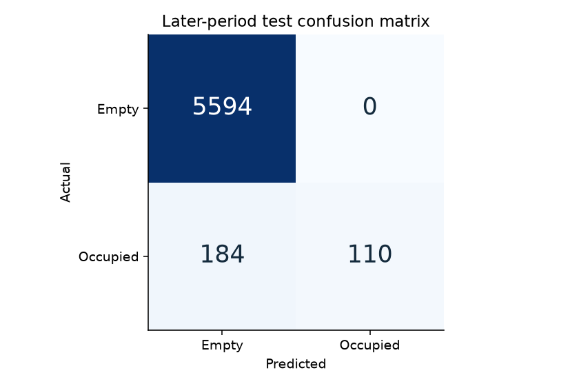
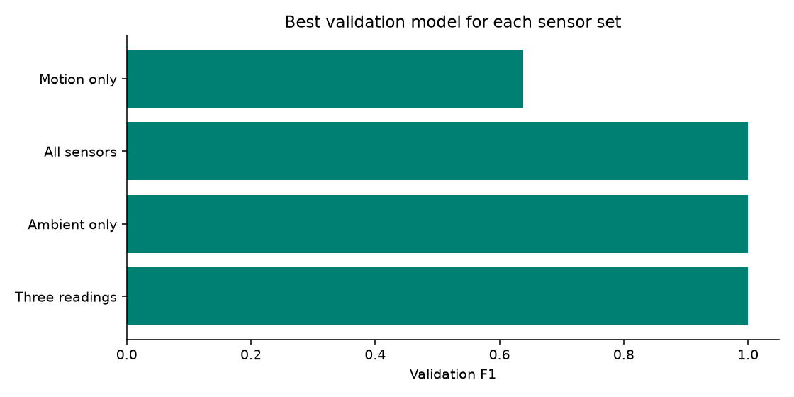

# Reproduced experimental results

Selected model: **Decision Tree / Three readings**. Selection used validation F1 only, with documented tie breakers; test scores did not select the winner. The final model was refit on the first two observed days.

The selected model detects **37.4% of occupied test readings**, with **184 false-empty predictions**. Its 96.9% accuracy must be interpreted alongside that occupied recall. This is a research prototype and empty predictions are not sufficient for equipment-control decisions.

| Final test metric | Value |
|---|---:|
| Accuracy | 0.9688 |
| Balanced accuracy | 0.6871 |
| Occupied precision | 1.0000 |
| Occupied recall | 0.3741 |
| Occupied F1 | 0.5446 |
| Average precision | 0.4054 |
| False-empty predictions | 184 |
| Majority baseline accuracy | 0.9501 |
| Majority baseline occupied F1 | 0.0000 |

## Diagnostic test comparisons

These comparisons describe the fixed experiments. They must not be used to repeatedly tune the final model on the test period.

| Sensor set | Algorithm | F1 | Occupied recall | False empty |
|---|---|---:|---:|---:|
| All sensors | Logistic Regression | 0.5446 | 0.3741 | 184 |
| All sensors | Decision Tree | 0.5446 | 0.3741 | 184 |
| All sensors | Random Forest | 0.5446 | 0.3741 | 184 |
| Ambient only | Logistic Regression | 0.5446 | 0.3741 | 184 |
| Ambient only | Decision Tree | 0.5446 | 0.3741 | 184 |
| Ambient only | Random Forest | 0.5446 | 0.3741 | 184 |
| Three readings | Logistic Regression | 0.5446 | 0.3741 | 184 |
| Three readings | Decision Tree | 0.5446 | 0.3741 | 184 |
| Three readings | Random Forest | 0.5446 | 0.3741 | 184 |
| Motion only | Logistic Regression | 0.8736 | 0.7993 | 59 |
| Motion only | Decision Tree | 0.8736 | 0.7993 | 59 |
| Motion only | Random Forest | 0.8736 | 0.7993 | 59 |

The later test period is dominated by empty readings. Accuracy alone is misleading; inspect occupied recall and the per-day table in `daily_test_metrics.csv`. A single room and a short experiment cannot establish performance in other buildings. The data contains long recording gaps; these are not evidence of vacancy.

Dataset SHA256: `c090ee5c94b61762bfec9d22767864490b51030f98cca030f02822468db25d9c`. Random seed: 42. scikit-learn: 1.9.1.
